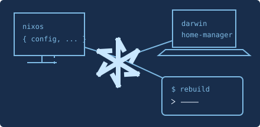
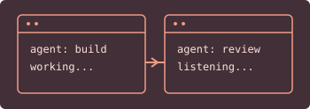

# Lucas Zanoni

Platform engineer in Brazil. I make systems reproducible and tools my own.

## [.dotfiles](https://github.com/Castrozan/.dotfiles)

One configuration for NixOS and macOS.

| [clawde](https://github.com/Castrozan/clawde)     | [whisper-input](https://github.com/Castrozan/whisper-input) |
| ------------------------------------------------- | ----------------------------------------------------------- |
|  |       |
| Persistent agents and declarative workspaces.     | Speak, transcribe and keep it local.                        |

## Also exploring

[From OpenAPI to conversational interfaces](https://github.com/Castrozan/tcc), my final-year project.
