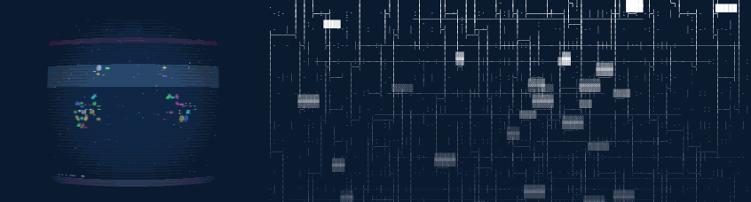
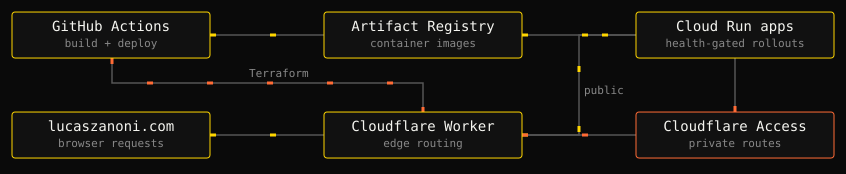

# Lucas Zanoni

AI engineer from Brazil. I specialize in applying AI to build great software, turning ideas into production systems.

Two scenes from [Ambient Canvas](https://github.com/Castrozan/.dotfiles/tree/main/machine-configuration/desktop/appearance/screensaver/ambient-canvas), my procedural screensaver. Recorded from the actual renderers.

## Pick a rabbit hole

| #   | Project                                                       | What's inside                                                                                          |
| --- | ------------------------------------------------------------- | ------------------------------------------------------------------------------------------------------ |
| 1   | [.dotfiles](https://github.com/Castrozan/.dotfiles)           | One Nix configuration for my NixOS and macOS machines, from desktop and editor to the agent tools.     |
| 2   | [clawde](https://github.com/Castrozan/clawde)                 | Persistent Claude Code agents with scheduled heartbeats, messaging channels and sessions I can resume. |
| 3   | [wellput](https://github.com/Castrozan/wellput)               | Writing rules and hooks that help coding agents explain their work clearly while I juggle sessions.    |
| 4   | [Castrozan/Castrozan](https://github.com/Castrozan/Castrozan) | How this README works: GitHub Markdown, synchronized GIFs, a recorded flip and scheduled refreshes.    |

## How [lucaszanoni.com](https://lucaszanoni.com) reaches the edge

