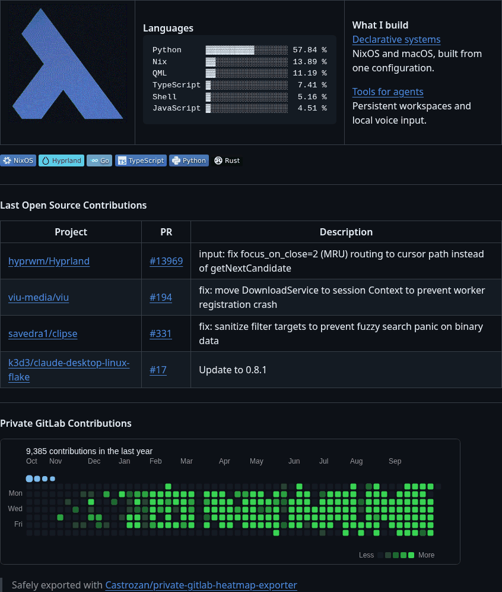

# One-hour native Markdown GIF stress fixture

This extends only the static reverse-face reading interval of the native Markdown recording. It tests encoded duration without adding turns or pretending the page was recorded continuously for an hour.

11,091,989 bytes, 3,600 seconds, two turns and 389 frames. Each individual frame delay stays within GIF89a's 16-bit delay field.

